# MakerBuddy IoT Kit — Fritzing parts and SVG drawings

Drawings of the [MakerBuddy IoT Kit V1.0](https://makerbuddy.cc) board and the parts that plug
into it, in two forms:

- **Fritzing parts**: one parts bin with the whole kit, plus each part on its own.
- **Plain SVG files** of the same drawings (breadboard picture, schematic symbol, PCB footprint)
  for any other tool: Inkscape, Figma, draw.io, Cirkit Designer, slides, worksheets, a website.

The kit has no loose wires: every sensor reaches the board through a cable with a plug. The parts
work the same way. Each sensor comes **with its cable and plug**. Drop the plug on a socket of the
board and all its pins connect at once.

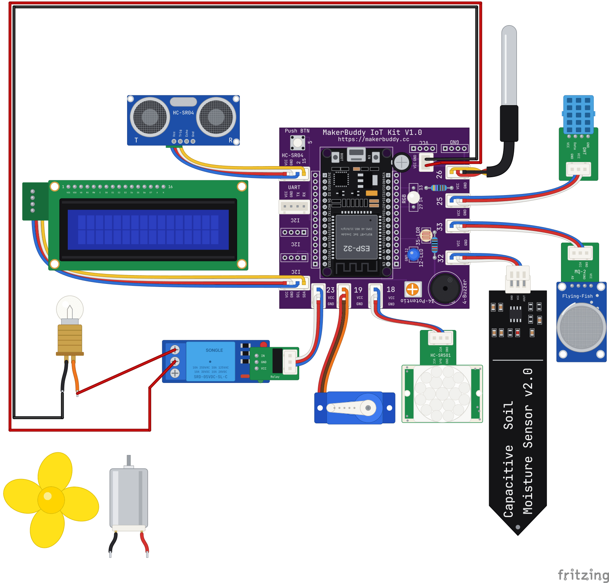

*The example sketch in `examples/`, opened and exported by Fritzing 1.0.2. Only the lamp is wired
by hand, as in the real kit: its leads go to the relay's screw terminals.*

## The parts

| | Part | Plug pins | Its socket on the board | File name |
|---|---|---|---|---|
| 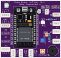 | **MakerBuddy IoT Kit V1.0, purple** <br>ESP32 DevKit carrier, 76 × 72.3 mm | 81 pins | – | `makerbuddy-iot-kit-v1-purple` |
| 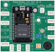 | **MakerBuddy IoT Kit V1.0, green** <br>The same board in green soldermask | 81 pins | – | `makerbuddy-iot-kit-v1-green` |
|  | **DS18B20** waterproof temperature probe, on its own lead | DQ, VCC, GND | **26** | `ds18b20-probe` |
| 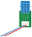 | **DHT11** temperature and humidity sensor | DATA, VCC, GND | **25** | `dht11` |
| 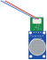 | **MQ-2** gas and smoke sensor | AO, VCC, GND | **33** | `mq2-gas-sensor` |
| 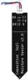 | **Capacitive soil moisture sensor** v2.0 | AOUT, VCC, GND | **32** | `soil-moisture-sensor` |
| 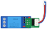 | **Relay module**, 5 V, 1 channel <br>plus screw terminals NO, COM, NC | IN, VCC, GND | **23** | `relay-module` |
| 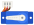 | **SG90** micro servo, on its own lead | PWM, VCC, GND | **19** | `sg90-servo` |
| 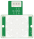 | **HC-SR501** PIR motion sensor | OUT, VCC, GND | **18** | `hc-sr501-pir` |
| 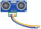 | **HC-SR04** ultrasonic distance sensor | VCC, GND, Echo, Trig | **HC-SR04** | `hc-sr04` |
| 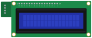 | **LCD 16 × 2** with I2C backpack (0x27) | VCC, GND, SCL, SDA | **I2C** (the one with a socket) | `lcd-1602-i2c` |
|  | **DC motor with fan**, two bare leads | M+, M− | relay terminals + **5V** | `dc-motor-fan` |
| 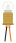 | **Lamp**, 6 V, two bare leads | L1, L2 | relay terminals + **5V** | `lamp` |

The purple and green boards are the same design in two soldermask colours. In Fritzing they are
one family: place either one and switch the colour in the Inspector.

Every pin of every part is listed in [docs/PINOUT.md](docs/PINOUT.md).

## Use the parts in Fritzing

Get the parts:

1. Download [`fritzing/MakerBuddy-IoT-Kit.fzbz`](fritzing/MakerBuddy-IoT-Kit.fzbz).
2. In Fritzing choose **File > Open** and pick the file (or drag it onto the Fritzing window).
3. A parts bin called **MakerBuddy IoT Kit** appears in the Parts window.

Build a circuit, in the Breadboard view:

1. Drag the board from the bin onto the page.
2. Drag a sensor from the bin and **drop its plug on the socket with its number**: the DHT11 on
   `25`, the DS18B20 probe on `26`, and so on (the table above). All the plug's pins connect at
   once. No wires to draw.
3. Each part is drawn where it lies when it is in its own socket, so the whole kit fits around the
   board without overlapping, as in the picture above.

Good to know:

- **It does not have to be exact.** Each socket pin accepts a plug pin anywhere in its slice of
  the socket. If the plug looks like it is in the socket, it is connected.
- **Check it:** press and hold the mouse button on a pin of the plug. Fritzing highlights
  everything that pin is connected to. Hold the mouse over any pin to read its name.
- **A plug goes where you put it.** Fritzing cannot stop a DHT11 going into socket `23`. It
  connects there too, as in real life, and the firmware will not find it. Use the number.
- **Other sockets:** to try a part on another edge of the board, turn it first (right-click >
  Rotate). The 3-pin plugs all have the same order: signal, VCC, GND, with GND toward the edge.
- **Lamp and fan** have bare leads, as in the kit. Draw wires: the `5V` socket's VCC to the relay's
  `COM`, the relay's `NO` to one lead, the other lead to the `5V` socket's GND.
- To open one part only, open its `.fzpz` file from [`fritzing/parts/`](fritzing/parts). It lands
  in the **MINE** bin.
- [`examples/MakerBuddy-IoT-Kit-wiring.fzz`](examples/MakerBuddy-IoT-Kit-wiring.fzz) shows the
  whole kit plugged in. It carries its own copy of the parts.

### Modules without a cable

[`fritzing/parts/module-only/`](fritzing/parts/module-only) has the seven modules on their own,
with their JST socket as the pins, for wiring a module by hand with ordinary Fritzing wires. They
are not in the bin, so the bin shows each sensor once. Their sockets take a plug the same way the
board's do.

## Use the drawings in other tools

[`svg/breadboard/`](svg/breadboard) holds the pictures, [`svg/schematic/`](svg/schematic) the
symbols and [`svg/pcb/`](svg/pcb) the footprints. They are the same files Fritzing uses.

- Plain SVG 1.1, sized in millimetres at true scale: **one unit in the file is one millimetre**.
- No fonts, no CSS, no gradients, no linked images. All lettering is outlines, so the drawings
  look the same everywhere and scale to any size.
- Every pin is one element with the id `connector<n>pin`, where `n` is the number in
  [docs/PINOUT.md](docs/PINOUT.md). A script or a tool that reads SVG can find each pin by its id.
- The footprints have white silkscreen, so they look empty on a white page.
  [`docs/pcb/`](docs/pcb) has copies on a green background for viewing.

## The board's connectors

VCC on this board is the DevKit's VIN pin: 5 V from the USB socket. The numbers printed beside the
3-pin connectors are GPIO numbers.

| Printed on the board | On the photographed boards | Pins, in printed order | Kit part |
|---|---|---|---|
| `26` | 3-pin JST-XH socket | signal (GPIO 26, 4.7 k pull-up to VCC), VCC, GND | DS18B20 probe |
| `25` | 3-pin JST-XH socket | signal (GPIO 25), VCC, GND | DHT11 |
| `33` | 3-pin JST-XH socket | signal (GPIO 33), VCC, GND | MQ-2 |
| `32` | 3-pin JST-XH socket | signal (GPIO 32), VCC, GND | Soil moisture sensor |
| `23` | 3-pin JST-XH socket | signal (GPIO 23), VCC, GND | Relay |
| `19` | 3-pin JST-XH socket | signal (GPIO 19), VCC, GND | Servo |
| `18` | 3-pin JST-XH socket | signal (GPIO 18), VCC, GND | PIR motion sensor |
| `HC-SR04` | 4-pin JST-XH socket | VCC, GND, 2 (Echo), 15 (Trig) | HC-SR04 |
| `UART` | 4-pin JST-XH socket | VCC, GND, TX (GPIO 17), RX (GPIO 16) | – |
| `I2C` (three) | bottom one: 4-pin JST-XH socket. Top two: four bare holes | VCC, GND, SCL (GPIO 22), SDA (GPIO 21) | LCD |
| `5V` | 2-pin JST-XH socket | VCC, GND | supply for the relay's load |
| `VCC`, `GND` | two rows of four bare holes | 5 V, ground | – |
| (not printed) | a row of 15 bare holes beside each DevKit pin row | the DevKit pin next to it | – |

Built into the board, so not connectors: push button (GPIO 5), LED (12), RGB LED (13, 14, 27),
potentiometer (34), light sensor (35) and buzzer (4). Their GPIOs are on the breakout holes.

In the parts the three I2C positions are named `I2C1` (bottom, the one with the socket), `I2C2`
and `I2C3` (top).

## How exact the drawings are

- **Board, exact:** the outline, every hole and pad position, the traces and the printed text come
  from the Fritzing design file of PCB V1.0, to 0.01 mm. GPIO numbers were checked against the
  board's netlist and the MakerBuddy firmware.
- **Board, from photographs:** the look and size of the parts on it (DevKit details, sockets,
  capacitor, buzzer and so on) and the two soldermask colours.
- **One correction to the design file:** on the manufactured boards the `5V` socket sits one hole
  to the left of where the design file has it, with `5V` printed to its right. The parts follow
  the manufactured boards.
- **Modules, from datasheets:** HC-SR04 (45 × 20 mm), LCD (80 × 36 mm), MQ-2 board (20 × 32 mm),
  soil sensor (98 × 23 mm), DHT11 body and SG90 body.
- **Modules, scaled from photographs:** the green MakerBuddy JST adapters, the relay module and the
  PIR board. Expect them to be right to about a millimetre.
- **Cables:** drawn short and in one fixed shape per part, so the kit fits on a page. The wire
  colours are the kit's: blue, white, red for signal, VCC, GND on the 3-wire cable, and red, white,
  blue, yellow on the 4-wire cable. The servo and the probe have their own leads and colours.
- **Shortened:** the DS18B20 lead (1 m on the real part) and the servo, motor and lamp leads.
- **HC-SR04 and LCD:** their JST socket is on the back, so the cable is drawn going under them.
  The plug's pins are in the board's order (VCC, GND, Echo, Trig and VCC, GND, SCL, SDA).
- **Assumed:** the order of the four solder joints on the LCD's adapter tab (GND, VCC, SDA, SCL
  from the top, as on a standard PCF8574 backpack). The pin names are right either way.
- **Footprints:** a part with a plug gets the footprint of the socket it plugs into (a pin
  header, 2.54 mm spacing). The module-only parts show the module's outline and where its socket
  sits. Nobody has made a PCB from them yet: check them against your own part before ordering one.
- The V1.0 board is the one drawn here. It is the board in the kit and in the photographs.

## What was tested

- `tools/build.py` checks every part before it writes anything: each pin is drawn exactly once in
  the breadboard, schematic and PCB drawings, the schematic has a wire end point for every pin, the
  layer names are the ones Fritzing looks for, and no drawing uses anything Fritzing cannot read.
- Fritzing 1.0.2 on macOS opened the example sketch, in which nine plugs sit in their sockets with
  no wires and the lamp is wired through the relay, and exported the breadboard, schematic and PCB
  views with no errors. The picture at the top of this page is that export.
- An earlier version of the parts bin was opened in Fritzing 1.0.2 and appeared in the Parts
  window with all its parts.
- **Not confirmed by hand yet:** dragging a part from the bin and dropping its plug on a socket.
  It relies on what Fritzing does for every part with pins (a part pushed into a breadboard, a
  shield on an Arduino): pins dropped on sockets connect.
- **Not tested:** older Fritzing versions, Windows and Linux, and PCB fabrication from the
  footprints. If something does not work, please
  [open an issue](https://github.com/MakerBuddy/MakerBuddy-IoT-Kit-Fritzing-Parts/issues).

## What is in this repository

| Path | What |
|---|---|
| `fritzing/MakerBuddy-IoT-Kit.fzbz` | The parts bin: the two boards and the 11 kit parts in one file |
| `fritzing/parts/*.fzpz` | Each part on its own |
| `fritzing/parts/module-only/*.fzpz` | The seven modules without a cable |
| `fritzing/fzp/*.fzp` | The part definitions as readable XML (already inside the files above) |
| `svg/breadboard/`, `svg/schematic/`, `svg/pcb/` | The drawings as plain SVG |
| `examples/MakerBuddy-IoT-Kit-wiring.fzz` | Fritzing sketch: the whole kit plugged into the board |
| `docs/PINOUT.md` | Every pin of every part |
| `docs/pcb/` | The footprints on a green background, for viewing |
| `tools/` | The Python scripts that draw and package everything |

## Rebuilding

Everything except this README is written by one script. `tools/board.py` draws the board,
`tools/modules.py` the modules, and `tools/plugin.py` gives each one its cable and plug and decides
where it lies beside the board. Change one, then:

```bash
pip install fonttools
```

```bash
python3 tools/build.py
```

The lettering is outlined from two open fonts (SIL Open Font License 1.1) that are not stored
here. Put these three files in `tools/fonts/` first:

- `JetBrainsMono-Medium.ttf` from [JetBrains Mono](https://github.com/JetBrains/JetBrainsMono)
- `Inter-Regular.ttf` and `Inter-SemiBold.ttf` from [Inter](https://github.com/rsms/inter)
  (the static files, not the variable font)

Or point `MB_FONT_MONO`, `MB_FONT_SANS` and `MB_FONT_BOLD` at any three font files.

If you change a part that people may already have installed, raise the `r2` at the end of its
module id (`board.py`, `modules.py`, `plugin.py`). Fritzing keeps parts by that id and will not replace an
installed part with a different one of the same id.

The board's geometry is in `tools/data/board_v1.json`.

## Licence

[Creative Commons Attribution-ShareAlike 4.0](LICENSE), the licence of the MakerBuddy PCB design
and the usual one for Fritzing parts. © 2026 Muhammad Afzal / MakerBuddy.

You may use the parts and drawings in your own diagrams, lessons and documents, including
commercial ones. Say where they came from, and share changed versions of the parts under the same
licence.

MakerBuddy: [makerbuddy.cc](https://makerbuddy.cc) · board design files:
[MakerBuddy/MakerBuddy-V1](https://github.com/MakerBuddy/MakerBuddy-V1)
